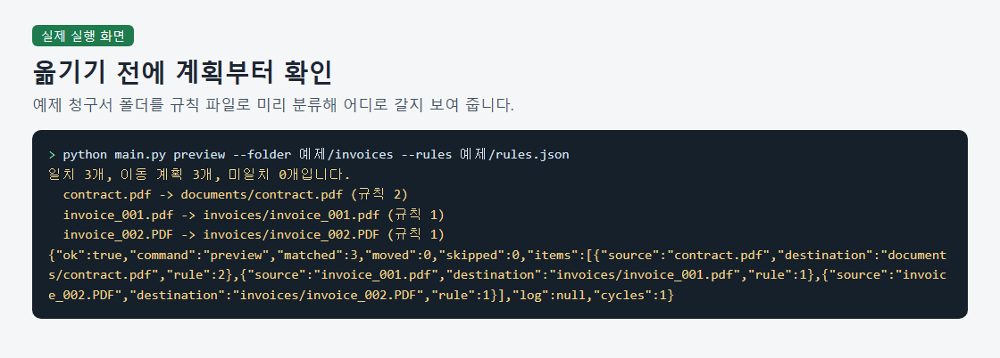
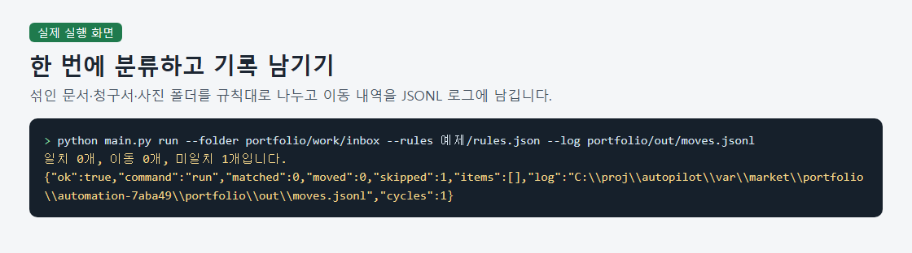
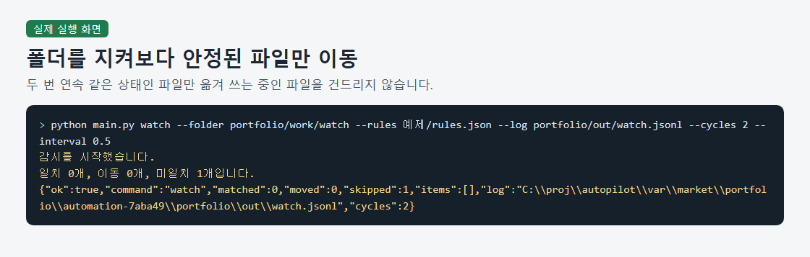
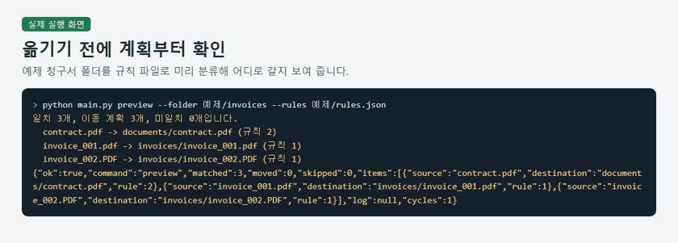

# File Sorting with Move Logs

> A Python command-line tool that sorts files by extension and filename rules, previews planned moves, and records completed moves in JSONL logs.

## The problem it solves

People managing download or work folders have to sort mixed documents, invoices, and images by hand. They also need a way to check where files will go and trace their locations after sorting.

## What it does

- Matches files against extension and filename rules, applying the first matching rule.
- Previews planned moves without moving files or creating destination folders.
- Sorts files in a single run and appends move records to a JSONL log.
- Watches a folder at a specified interval and moves files whose state stays unchanged across two consecutive observations.
- Adds numbered suffixes when filenames collide and provides Korean error explanations with corrective guidance.

## How to run

1. Use Python and open a terminal in the extracted project folder. The supplied records cover Python 3.12.10 and 3.14.3; the tool uses only the standard library, so no package installation is needed.
2. Preview the example files without moving them: python main.py preview --folder 예제/invoices --rules 예제/rules.json
3. Create a copy of the examples for sorting: python -c "import shutil; shutil.copytree('예제/invoices', 'test_inbox')"
4. Sort the copied files and record their moves: python main.py run --folder test_inbox --rules 예제/rules.json --log moves.jsonl

Sample files: `예제/rules.json`, `예제/documents/memo.txt`

## Notes and limits

Execution records cover synthetic samples and fresh example copies on one Windows 10 PC; real business files, other PCs, and other operating systems remain untested. Processing covers only regular files directly inside the selected folder, excluding subfolders and symbolic links.

Tech: Python, argparse, fnmatch, JSON, JSONL

## 한국어 안내 — 규칙으로 파일을 분류하고 이동 기록 남기기

> 확장자와 파일 이름 규칙으로 파일을 분류하고, 이동 계획을 미리 확인하며, 옮긴 내역을 JSONL 로그로 남기는 파이썬 명령줄 도구입니다.

### 해결한 문제

다운로드 폴더나 작업 폴더를 관리하다 보면 문서, 청구서, 이미지가 뒤섞여 일일이 나누기 번거롭습니다. 정리 전에 파일이 어디로 갈지 확인하고, 정리한 뒤에도 이동 경로를 찾아볼 수 있어야 합니다.

### 하는 일

- 확장자와 파일 이름 조건을 비교해 처음 일치하는 규칙으로 분류합니다.
- 파일을 옮기거나 대상 폴더를 만들지 않고 이동 계획만 보여 줍니다.
- 한 번에 파일을 분류하고 이동 내역을 JSONL 로그에 이어 씁니다.
- 지정한 간격으로 폴더를 관찰하고 연속 두 번 상태가 같았던 파일을 옮깁니다.
- 동명 파일에는 번호를 붙이고, 오류가 나면 한국어 설명과 해결 방법을 안내합니다.

### 실행 방법

1. 파이썬을 준비하고 압축을 푼 프로젝트 폴더에서 터미널을 엽니다. 제공된 기록에서 시험한 버전은 3.12.10과 3.14.3이며, 표준 라이브러리만 사용하므로 별도 패키지 설치는 필요하지 않습니다.
2. 예제 파일을 옮기지 않고 이동 계획을 확인합니다: python main.py preview --folder 예제/invoices --rules 예제/rules.json
3. 분류에 사용할 예제 복사본을 만듭니다: python -c "import shutil; shutil.copytree('예제/invoices', 'test_inbox')"
4. 복사본을 분류하고 이동 내역을 기록합니다: python main.py run --folder test_inbox --rules 예제/rules.json --log moves.jsonl

### 한계

실행 기록은 Windows 10 PC 한 대에서 가상 표본과 새 예제 복사본으로 시험한 범위이며, 실제 업무 자료와 다른 PC·운영체제는 시험하지 않았습니다. 선택한 폴더 바로 아래의 일반 파일만 처리하고 하위 폴더와 심볼릭 링크는 제외합니다.

---
Category: 업무 자동화 · Built and tested with Claude Code. Every number above comes from a real run on this machine.
