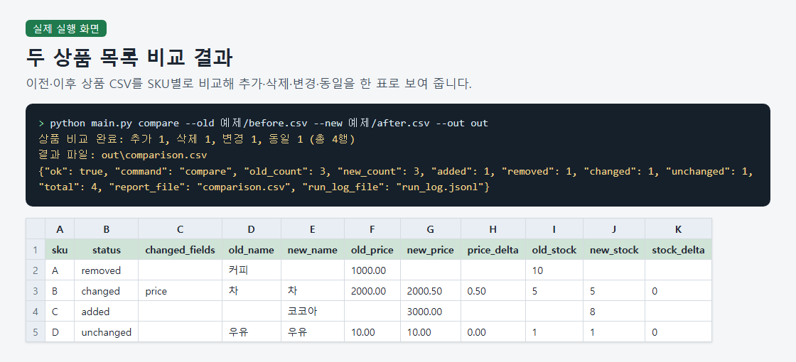
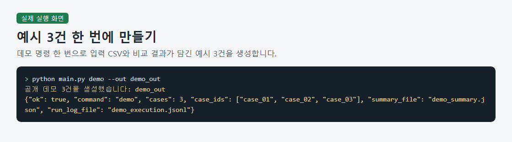
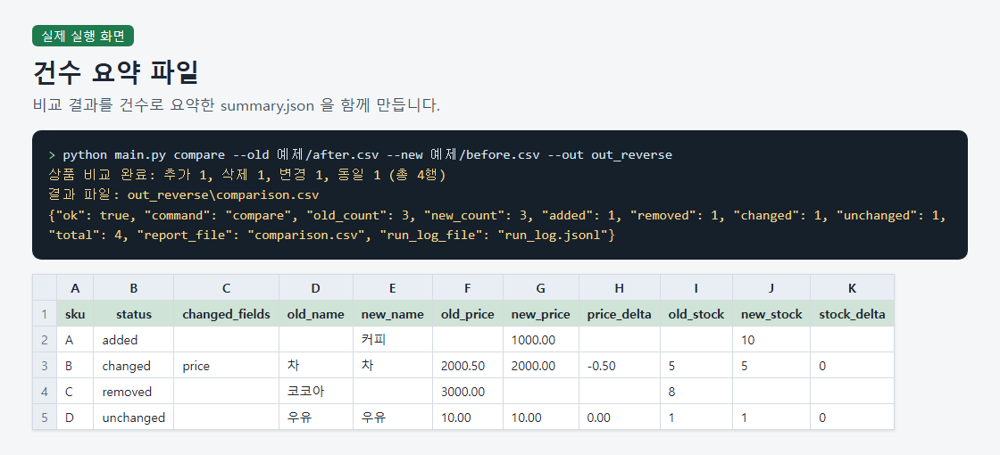
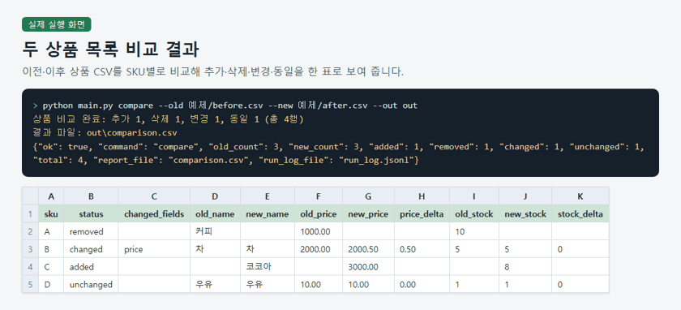

# Compare Product CSVs and Track Changes

> A Python command-line tool that compares two product CSVs by SKU and saves product statuses, changed fields, price and stock differences, counts, and execution logs.

## The problem it solves

People comparing product lists in spreadsheets can miss changes to names, prices, or stock when checking rows by eye. Matching the two files by SKU brings additions, removals, and changes into one comparison table.

## What it does

- Reads product CSVs with sku,name,price,stock columns and validates the input.
- Classifies each SKU as added, removed, changed, or unchanged.
- Records changed fields and calculates price and stock differences, using Decimal for prices displayed to two decimal places.
- Saves a CSV comparison table, a JSON count summary, and a JSONL execution log.
- Generates three synthetic examples with input CSVs and comparison results.
- Reports missing files, invalid headers, and missing required arguments with Korean guidance, a machine-readable JSON line, and exit code 2.

## How to run

1. Prepare Python 3. The tool uses only the standard library, so no additional packages are needed.
2. Compare the supplied synthetic product lists: python main.py compare --old 예제/before.csv --new 예제/after.csv --out out
3. Generate three synthetic examples with input CSVs and comparison results: python main.py demo --out demo_out
4. Reverse the input order for another comparison and inspect summary.json in out_reverse for the counts: python main.py compare --old 예제/after.csv --new 예제/before.csv --out out_reverse

Sample files: `예제/after.csv`, `예제/before.csv`

## Notes and limits

Execution has been confirmed with synthetic samples; real customer data, large CSV files, compatibility across operating systems and Python versions, and CSV formula injection defenses have not been verified. Output files are written sequentially, so a failure can leave earlier files in place without automatic recovery.

Tech: Python 3 standard library, CSV input and output, JSON summaries and JSONL execution logs, Decimal price calculations, Command-line interface, Input validation

## 한국어 안내 — 상품 CSV 비교와 가격·재고 변경 정리

> 두 시점의 상품 CSV를 SKU 기준으로 비교해 상품별 상태, 변경 항목, 가격·재고 차이, 건수 요약과 실행 기록을 저장하는 Python 명령줄 도구입니다.

### 해결한 문제

상품 목록을 스프레드시트에서 눈으로 대조하면 이름·가격·재고가 바뀐 행을 놓치기 쉽습니다. 이전·이후 파일을 SKU 기준으로 맞춰 추가·삭제·변경 내역을 한 표에서 확인할 수 있도록 했습니다.

### 하는 일

- sku,name,price,stock 열을 가진 상품 CSV를 읽고 입력 데이터를 검증합니다.
- SKU별로 추가·삭제·변경·동일 상태를 판정합니다.
- 변경 항목과 가격·재고 차이를 기록하며, 가격은 Decimal로 계산해 소수 둘째 자리까지 출력합니다.
- 비교표는 CSV, 건수 요약은 JSON, 실행 기록은 JSONL로 저장합니다.
- 가상 입력 CSV와 비교 결과를 포함한 예시 3건을 생성합니다.
- 없는 파일·잘못된 헤더·필수 인자 누락에는 한국어 안내와 기계 처리용 JSON 한 줄을 출력하고 종료 코드 2로 끝납니다.

### 실행 방법

1. Python 3을 준비합니다. 표준 라이브러리만 사용하므로 별도로 설치할 패키지는 없습니다.
2. 제공된 가상 상품 목록을 비교합니다: python main.py compare --old 예제/before.csv --new 예제/after.csv --out out
3. 입력 CSV와 비교 결과를 포함한 가상 예시 3건을 생성합니다: python main.py demo --out demo_out
4. 입력 순서를 바꿔 비교하고 out_reverse의 summary.json에서 건수 요약을 확인합니다: python main.py compare --old 예제/after.csv --new 예제/before.csv --out out_reverse

### 한계

실행 확인은 가상 표본에 한정되며, 실제 고객 자료·대용량 CSV·다른 운영체제와 Python 버전의 호환성·CSV 수식 주입 방어는 검증하지 않았습니다. 결과 파일을 차례로 쓰므로 도중에 실패하면 앞서 쓴 파일이 남을 수 있고 자동 복구 장치는 없습니다.

---
Category: 업무 자동화 · Built and tested with Claude Code. Every number above comes from a real run on this machine.
