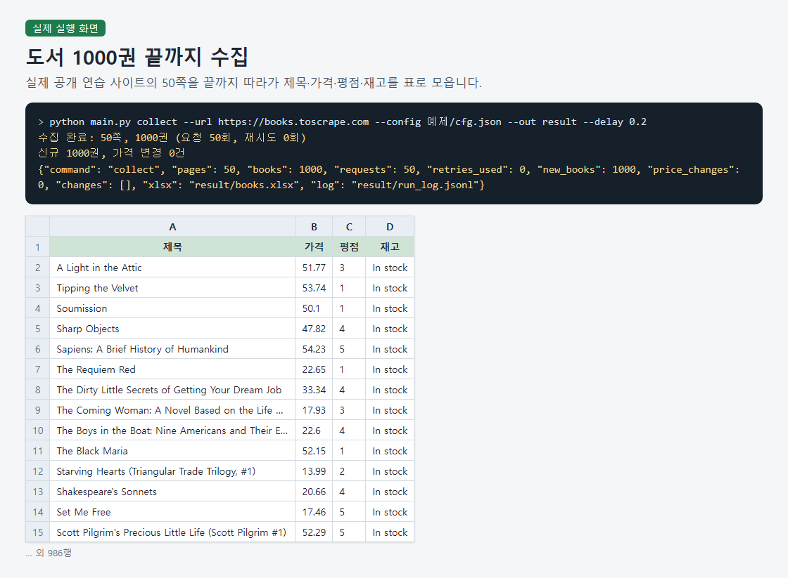
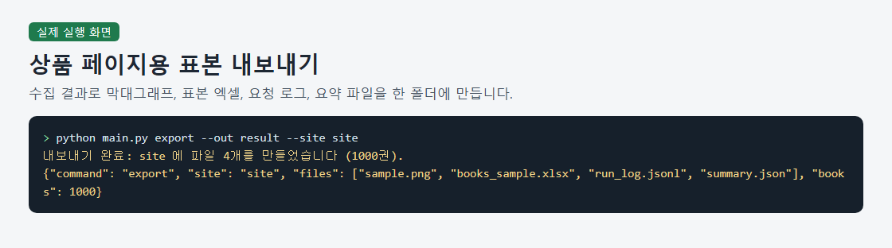
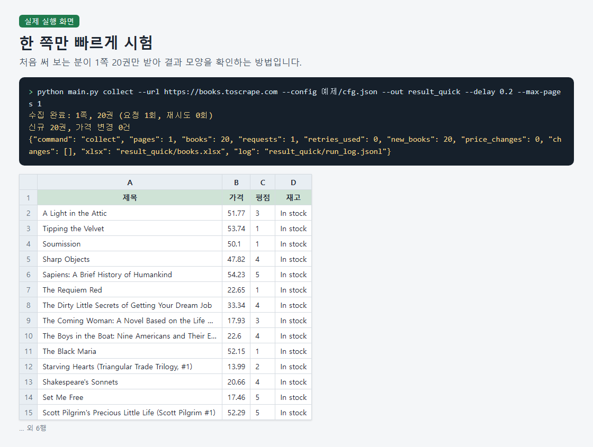
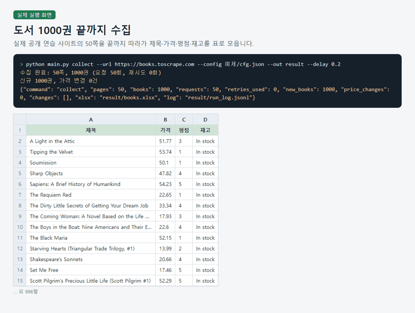

# Book Listing Scraper Sample Kit

> A standard-library Python command-line tool that crawls all 50 pages of a public practice bookstore and produces an Excel workbook, price-change comparison, request log, and a sample folder for a product page.

## The problem it solves

Before commissioning a scraping job, buyers want to see what the deliverable looks like. Descriptions alone don't show what a rerun reports or what happens when a request fails, so this kit produces a real sample of each.

## What it does

- Follows the "next" links through every listing page and collects title, price, rating (1 to 5) and stock for each book.
- Writes an Excel workbook with three sheets (book list, summary, price changes) plus a CSV file. The column order comes from a config file.
- On a rerun in the same folder, reports new books and price changes against the previous results and keeps earlier entries that did not appear this time.
- Logs every request attempt as one line: time, URL, attempt number, success, status code and error. Delay and retry count are options.
- Rejects invalid config or options before any request is sent, with a message in Korean.
- Exports a product-page folder with a rating bar chart, a sample workbook, the request log and a summary file.

## How to run

1. Install Python 3.7 or later. There are no packages to install.
2. Save the config as cfg.json (the bundled 예제/cfg.json works as is): {"fields": ["title", "price", "rating", "stock"]}
3. Collect all pages: python main.py collect --url https://books.toscrape.com --config 예제/cfg.json --out result --delay 0.2
4. To try just one page (20 books) first: python main.py collect --url https://books.toscrape.com --config 예제/cfg.json --out result_quick --delay 0.2 --max-pages 1
5. Export the product-page folder (run collect first): python main.py export --out result --site site

Sample files: `예제/cfg.json`, `sample/books.csv`

## Notes and limits

The parser is written for this one site's page structure, so other sites need their own parser, and on a changed page it may finish with zero books and no warning. It reads listing pages only, not detail pages.

Tech: Python 3, urllib, regex, zipfile, zlib, struct, argparse, JSON, xlsx, CSV

## 한국어 안내 — 도서 목록 수집 결과 표본 키트

> 공개 연습 사이트의 도서 목록 50쪽을 끝까지 수집해 엑셀, 가격 변경 비교, 요청 로그, 상품 페이지용 표본 폴더로 정리하는 파이썬 명령줄 도구입니다.

### 해결한 문제

크롤링을 맡기기 전에 구매자는 결과물이 어떤 모양인지 직접 보고 싶어 합니다. 설명만으로는 다시 돌렸을 때 무엇이 바뀌는지, 요청이 실패하면 어떻게 되는지 알기 어려워서, 실제로 만든 표본과 로그로 보여 주려고 만들었습니다.

### 하는 일

- 목록 페이지의 '다음' 링크를 따라 끝 쪽까지 도서별 제목, 가격, 평점(1~5), 재고를 수집합니다.
- 엑셀 파일(도서목록, 요약, 가격변경 시트 3개)과 CSV를 만들고, 열 순서는 설정 파일에서 정합니다.
- 같은 폴더로 다시 실행하면 이전 결과와 비교해 신규 도서와 가격 변경을 알려 주고, 이번에 나오지 않은 이전 항목은 지우지 않고 보존합니다.
- 요청을 시도할 때마다 시각, 주소, 시도 횟수, 성공 여부, 상태 코드, 오류를 한 줄씩 로그로 남기며, 요청 간격과 재시도 횟수는 옵션으로 정합니다.
- 잘못된 설정이나 옵션은 요청을 보내기 전에 한국어 안내와 함께 거절합니다.
- 평점별 권수 막대그래프, 표본 엑셀, 요청 로그, 요약 파일이 든 상품 페이지용 폴더를 한 번에 내보냅니다.

### 실행 방법

1. Python 3.7 이상을 준비합니다. 설치할 패키지는 없습니다.
2. 설정 파일을 cfg.json으로 준비합니다(예제/cfg.json을 그대로 써도 됩니다): {"fields": ["title", "price", "rating", "stock"]}
3. 전체를 수집합니다: python main.py collect --url https://books.toscrape.com --config 예제/cfg.json --out result --delay 0.2
4. 먼저 1쪽(20권)만 시험하려면: python main.py collect --url https://books.toscrape.com --config 예제/cfg.json --out result_quick --delay 0.2 --max-pages 1
5. 상품 페이지용 폴더를 내보냅니다(collect를 먼저 실행해야 합니다): python main.py export --out result --site site

### 한계

이 사이트 구조에 맞춘 파서라서 다른 사이트에는 그대로 쓸 수 없고, 구조가 바뀐 페이지에서는 도서 0건이어도 경고 없이 끝날 수 있습니다. 목록 페이지만 수집하며 상세 페이지는 다루지 않습니다.

---
Category: 크롤링 · Built and tested with Claude Code. Every number above comes from a real run on this machine.
