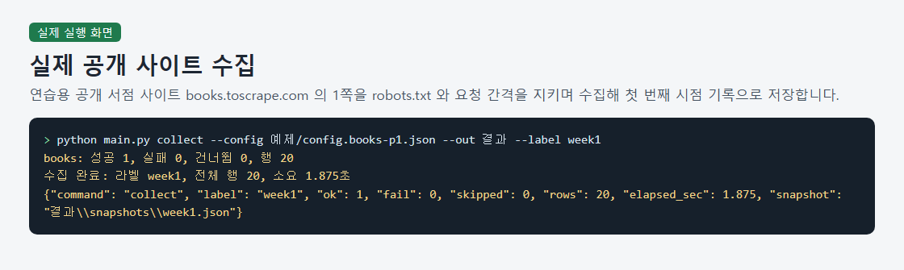
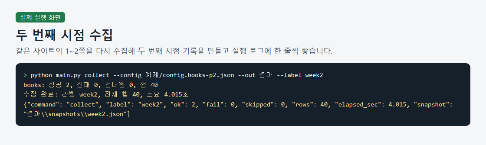
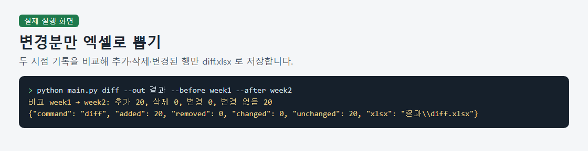
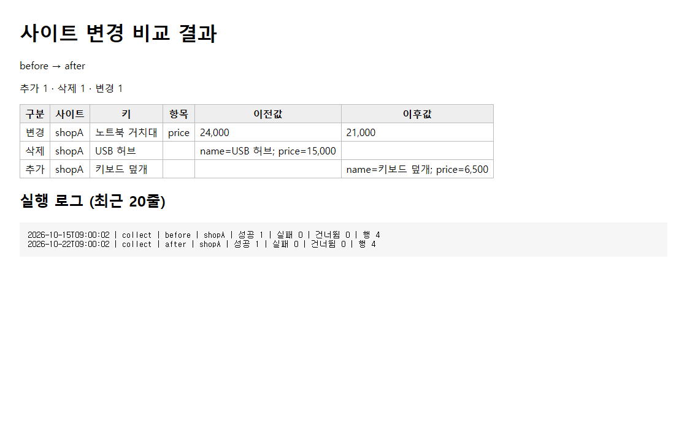

# Spreadsheet Reports for Collected List Changes

> A Python command-line tool that compares two saved collection records and produces an Excel file and an HTML page showing added, removed, and changed rows.

## The problem it solves

People who collect website listings repeatedly need to identify which rows have been added, removed, or changed since an earlier collection. This tool compares the saved records and puts the differences into files they can review.

## What it does

- Configures collection URLs, extraction patterns, row identifiers, and request intervals through a settings file.
- Saves collection records by label and writes an execution log.
- Exports added, removed, and changed rows to diff.xlsx and generates an index.html page with a summary, change tables, and execution logs.
- Found 20 added rows when comparing collections of 20 and 40 rows from a public bookstore practice site; a fictional store sample yielded one added, one removed, one changed, and two unchanged rows.
- Passed all seven hidden tests; five invalid-input cases produced Korean guidance and exited with code 2 during buyer verification.

## How to run

1. Prepare CPython 3.12.10, the version tested on Windows 10 64-bit build 19045, and open a terminal in the folder containing main.py. No additional packages are required.
2. Generate the viewing page from the included fictional store records without an internet connection: python main.py report --out 예제/샘플결과 --before before --after after
3. With an internet connection, collect page 1 of the public bookstore practice site as week1: python main.py collect --config 예제/config.books-p1.json --out 결과 --label week1
4. Collect pages 1–2 of the same site as week2: python main.py collect --config 예제/config.books-p2.json --out 결과 --label week2
5. Compare the two collected records and export the differences to diff.xlsx. This comparison produced 20 added rows, no removed or changed rows, and 20 unchanged rows: python main.py diff --out 결과 --before week1 --after week2

Sample files: `예제/config.books-p1.json`, `예제/config.books-p2.json`, `예제/config.sample.json`, `예제/샘플결과/snapshots/after.json`, `예제/샘플결과/snapshots/before.json`

## Notes and limits

Live collection was demonstrated only on one public bookstore practice site with different page ranges; price changes were confirmed only in fictional samples, and other sites require custom extraction settings, testing, and a review of their terms and collection permissions. Other Python versions were not tested, buyer verification did not include opening the outputs in a browser or spreadsheet application, and the documented local checks for robots.txt blocking and the 0.3-second request interval were not rerun during buyer verification; robots.txt lookups are excluded from interval calculations.

Tech: Python, Regular expressions, Excel file generation, HTML report generation

## 한국어 안내 — 수집한 목록의 변경 내역을 엑셀로 정리

> 저장된 두 수집 기록을 비교해 추가·삭제·변경된 행을 엑셀 파일과 HTML 보기 페이지로 만드는 파이썬 명령줄 도구입니다.

### 해결한 문제

사이트 목록을 반복해서 수집하는 사람은 이전 기록과 비교해 어떤 행이 추가·삭제·변경됐는지 확인해야 합니다. 저장된 두 기록의 차이를 비교하고 검토할 파일로 정리하는 작업을 돕습니다.

### 하는 일

- 설정 파일에서 수집 주소, 항목 추출 정규식, 행 구분 항목, 요청 간격을 지정합니다.
- 라벨별로 수집 기록을 저장하고 실행 로그를 남깁니다.
- 추가·삭제·변경된 행을 diff.xlsx로 내보내고 요약, 변경 표, 실행 로그가 있는 index.html 보기 페이지를 만듭니다.
- 공개 서점 연습 사이트에서 수집한 20행과 40행을 비교해 추가 20행을 확인했으며, 가상 상점 표본에서는 추가 1행·삭제 1행·변경 1행·변경 없음 2행을 확인했습니다.
- 숨긴 시험 7건을 모두 통과했으며, 구매자 검수의 잘못된 입력 5가지에서 한국어 안내와 종료코드 2를 확인했습니다.

### 실행 방법

1. Windows 10 64비트 빌드 19045에서 실행을 확인한 CPython 3.12.10을 준비하고, main.py가 있는 폴더에서 터미널을 엽니다. 추가 패키지는 필요하지 않습니다.
2. 인터넷 연결 없이 포함된 가상 상점 기록으로 보기 페이지를 만듭니다: python main.py report --out 예제/샘플결과 --before before --after after
3. 인터넷에 연결한 상태에서 공개 서점 연습 사이트의 1쪽을 수집해 week1으로 저장합니다: python main.py collect --config 예제/config.books-p1.json --out 결과 --label week1
4. 같은 사이트의 1~2쪽을 수집해 week2로 저장합니다: python main.py collect --config 예제/config.books-p2.json --out 결과 --label week2
5. 두 수집 기록을 비교해 변경분을 diff.xlsx로 내보냅니다. 이 비교에서는 추가 20행, 삭제 0행, 변경 0행, 변경 없음 20행을 확인했습니다: python main.py diff --out 결과 --before week1 --after week2

### 한계

실제 사이트 수집은 공개 서점 연습 사이트 한 곳에서 수집 쪽 수를 달리한 사례이며, 가격 변경은 가상 표본에서만 확인했고 다른 사이트에는 추출 설정 작성·시험과 이용약관·수집 허용 범위 확인이 필요합니다. 다른 파이썬 버전은 시험하지 않았고 구매자 검수에서 브라우저·엑셀 프로그램으로 결과 화면을 직접 확인하거나 문서에 기록된 로컬 robots.txt 차단·0.3초 요청 간격 검증을 재실행하지 않았으며, robots.txt 조회는 요청 간격 계산에서 제외됩니다.

---
Category: 크롤링 · Built and tested with Claude Code. Every number above comes from a real run on this machine.
