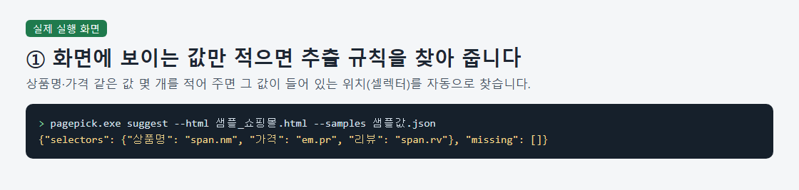
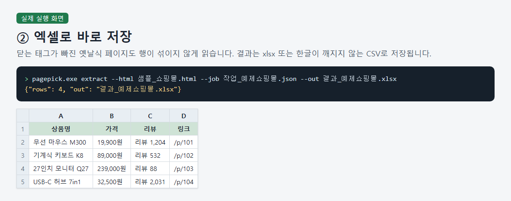
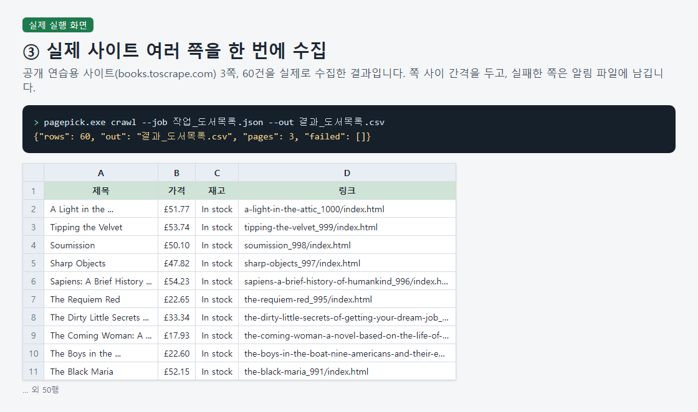
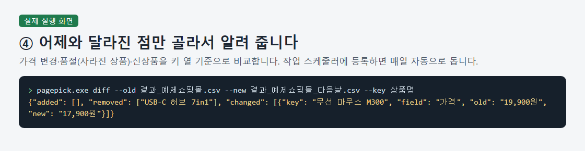

# Web list scraping to Excel, rerunnable

> A paid scraping service that delivers an Excel or CSV file of repeated web lists, plus a program and job settings so the buyer can rerun the collection later.

## The problem it solves

Sellers who check competitor prices and stock every day, and office staff who copy notice or board lists into Excel by hand, spend time on the same paste-and-tidy routine. A one-off file goes stale quickly, and it doesn't help when the list changes tomorrow. This project delivers the file and also a way to collect it again without a developer.

## What it does

- Walks through multiple pages automatically, with an adjustable delay between pages
- Saves to Excel (xlsx) or CSV, and reads older EUC-KR sites without garbled Korean text
- Compares with the previous result and records only price changes, removed items and new items
- If the site structure changes and nothing can be collected, writes a note to an alert file and keeps the previous result
- On errors, prints a Korean message with a one-line fix
- Includes a sample daily-run bat file and a user guide; on Windows the executable runs after unzipping, with no Python install

## Demo walkthrough

This folder shows the result only: screenshots and what comes out. The tool itself is a paid product, so its source code is not published here.

1. Input: send the page address and the fields you need (for example product name, price, link) by message. Feasibility is checked before you buy.
2. Input example: a job file like {"item": "article.product_pod", "fields": {"title": "h3", "price": "p.price_color", "link": "a@href"}, "url": "https://books.toscrape.com/catalogue/page-{page}.html", "pages": [1, 3], "delay_s": 2}. Result: a crawl over the three pages saves a table, and the summary shows {"rows": 60, "pages": 3, "failed": []}.
3. Input example: yesterday's and today's CSV compared on a key column. Result: a list of added, removed and changed rows (for example a price changing from 19,900 to 17,900 won). Windows Task Scheduler registration is not verified and is left to the buyer, following chapter 4 of the guide.

## Notes and limits

Pages that need login or CAPTCHA, sites that forbid scraping, and personal data collection are not handled. JavaScript-rendered pages work only from a saved HTML file, and because locating values uses plain tags and classes, complex shopping sites may not work. Multi-site runs were not tested, and the largest real-site check was 30 pages and 600 items on a public practice site.

Tech: Python, HTML parsing, Excel (xlsx) / CSV export, Windows executable, Windows batch file

## 한국어 안내 — 웹 목록 수집 엑셀 납품·재실행 도구

> 반복되는 웹 목록을 엑셀·CSV로 모아 납품하고, 납품 뒤에도 직접 다시 돌릴 수 있는 프로그램과 작업 설정을 함께 드리는 유료 수집 작업입니다.

### 해결한 문제

경쟁 쇼핑몰의 가격·재고를 매일 확인하는 판매자나 공고·게시판 목록을 엑셀에 복사해 붙이는 실무자는 같은 작업을 반복하느라 시간을 씁니다. 한 번 받은 파일은 금방 낡고, 내일 목록이 바뀌면 쓸모가 없어집니다. 그래서 결과 파일뿐 아니라 개발자 없이 다시 수집할 수 있는 프로그램까지 함께 드립니다.

### 하는 일

- 여러 쪽(페이지)을 자동으로 돌고, 쪽 사이 간격을 조절합니다.
- 엑셀(xlsx)·CSV로 저장하며, 옛 사이트(EUC-KR)도 한글이 깨지지 않습니다.
- 어제 결과와 비교해 가격 변경·사라진 항목·새 항목만 골라 기록합니다.
- 사이트 구조가 바뀌어 수집이 안 되면 알림 파일에 남기고 이전 결과는 그대로 보존합니다.
- 오류가 나면 한국어 문장과 고치는 방법 한 줄을 보여 줍니다.
- 매일 실행용 bat 예시와 사용설명서를 포함하고, 윈도우에서는 압축을 풀면 파이썬 설치 없이 바로 실행됩니다.

### 데모 보는 법

이 폴더는 화면, 결과 설명만 보여 줍니다. 실제 도구는 유료 상품이라 소스 코드는 올리지 않습니다.

1. 입력: 수집할 주소와 필요한 항목(예: 상품명·가격·링크)을 메시지로 보내 주세요. 구매 전에 수집 가능 여부를 먼저 확인합니다.
2. 입력 예시: {"item": "article.product_pod", "fields": {"제목": "h3", "가격": "p.price_color", "링크": "a@href"}, "url": "https://books.toscrape.com/catalogue/page-{page}.html", "pages": [1, 3], "delay_s": 2} 같은 작업 파일. 결과: 3쪽을 돌며 표로 저장하고 {"rows": 60, "pages": 3, "failed": []} 요약이 나옵니다.
3. 입력 예시: 어제 CSV와 오늘 CSV를 키 열 기준으로 비교. 결과: 새 항목·사라진 항목·바뀐 값(예: 가격 19,900원 → 17,900원) 목록이 나옵니다. 윈도우 작업 스케줄러 등록은 확인하지 못했으며, 사용설명서 4장을 보고 직접 해 보셔야 합니다.

### 한계

로그인·캡차가 필요한 페이지, 약관이나 robots.txt로 수집을 막은 사이트, 개인정보 수집은 하지 않습니다. 자바스크립트로 나중에 그리는 화면은 저장한 HTML 파일로만 가능하고, 위치 지정이 태그·클래스뿐이라 구조가 복잡한 쇼핑몰은 안 될 수 있습니다. 여러 사이트를 한 번에 도는 구성은 시험하지 않았고, 실제 사이트 확인은 연습용 공개 사이트 30쪽 600건까지입니다.

---
Category: 크롤링 · Built and tested with Claude Code. Every number above comes from a real run on this machine.
