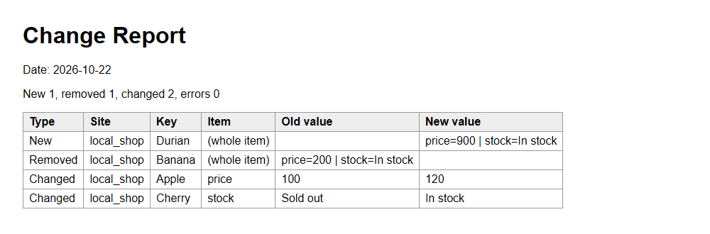
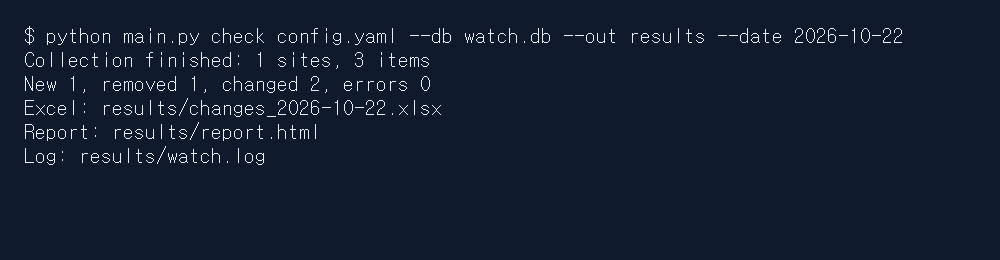
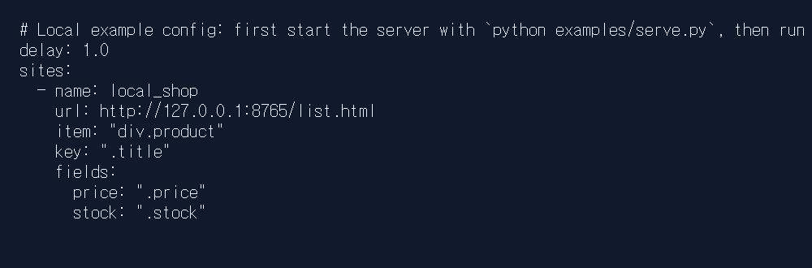

# Web List Changes in Spreadsheet Reports

> A privately distributed tool configured for a chosen web list that compares saved records and exports new, removed, and changed items to Excel and an HTML report.

## The problem it solves

People who track prices or announcements have to reopen list pages and compare them with earlier records. Purchasing staff checking supplier price lists face the same task: finding which items appeared, disappeared, or changed.

## What it does

- Reads lists from server-delivered HTML using site-specific item selectors, identifying keys, and comparison fields.
- Saves a baseline on the first run and compares subsequent runs with saved records.
- Reports new and removed items, with one row per changed field showing its previous and new values.
- Saves results as changes_<date>.xlsx and report.html.
- Processes multiple configured sites, recording a failed site while continuing with the others.
- Generates a batch file for registering a daily run in Windows Task Scheduler.

## Demo walkthrough

This folder shows the result only: screenshots and what comes out. The tool itself is a paid product, so its source code is not published here.

1. Input example → Use the supplied local test price list as a baseline, then change prices and stock values and add and remove items; the second check produces Excel and HTML reports containing the new, removed, and changed items.
2. Input example → Read the public practice book-list page; the recorded run saved prices and stock values for 20 books, with zero changes because it established the baseline.

## Notes and limits

Only server-delivered HTML is supported, with a limited selector syntax; JavaScript-rendered pages, login-required pages, pagination, and environments requiring a company proxy are unsupported, collection blocked by robots.txt is skipped, and results are saved to files without email or messenger alerts. Change detection was observed on a public news list and synthetic local data, but business shopping sites and announcement boards remain untested, generated scheduling files have not been registered or run in a scheduling test, and report files are overwritten on repeated runs, with Excel cells stored as text and no history or log cleanup feature.

Tech: Python standard library, urllib, html.parser, sqlite3, zipfile, Excel (.xlsx), HTML reports, Windows Task Scheduler batch-file generation

## 한국어 안내 — 웹 목록에서 바뀐 항목을 엑셀로 정리

> 지정한 웹 목록을 이전 기록과 비교해 신규·삭제·값 변경 항목을 엑셀과 웹 리포트로 정리하도록 설정해 드리는 코드 비공개 유료 도구입니다.

### 해결한 문제

가격이나 공지를 확인하는 사람은 목록 페이지를 다시 열고 이전 기록과 비교해야 합니다. 거래처 단가표를 챙기는 구매 담당자도 어떤 항목이 추가되거나 사라졌는지, 어느 값이 달라졌는지 찾아야 합니다.

### 하는 일

- 사이트별로 항목을 감싸는 요소, 식별값, 비교할 값을 설정해 서버가 보내는 HTML에서 목록을 읽습니다.
- 첫 실행에서는 기준선을 저장하고, 다음 실행부터 이전 기록과 비교합니다.
- 신규·삭제 항목을 표시하고, 값 변경은 필드마다 한 줄씩 이전값과 새값을 함께 보여 줍니다.
- 결과를 changes_<date>.xlsx와 report.html로 저장합니다.
- 여러 사이트를 처리하며, 한 곳이 실패해도 해당 사이트의 실패를 기록하고 나머지는 계속 처리합니다.
- 윈도우 작업 스케줄러에 매일 실행할 작업을 등록하는 배치 파일을 만듭니다.

### 데모 보는 법

이 폴더는 화면, 결과 설명만 보여 줍니다. 실제 도구는 유료 상품이라 소스 코드는 올리지 않습니다.

1. 입력 예시 → 직접 만든 로컬 시험용 가격표를 기준선으로 저장한 뒤 가격·재고를 바꾸고 항목을 추가·삭제합니다. 두 번째 확인 결과로 신규·삭제·변경 항목이 담긴 엑셀과 HTML 리포트가 생성됩니다.
2. 입력 예시 → 공개 연습용 도서 목록 페이지를 읽습니다. 실제 실행에서는 책 20권의 가격과 재고를 저장했고, 기준선을 만드는 실행이므로 변경 내역은 0건이었습니다.

### 한계

서버가 보내는 HTML과 제한된 셀렉터 문법만 지원하므로 자바스크립트 렌더링·로그인·쪽 넘김이 필요한 페이지와 회사 프록시가 필수인 환경에서는 사용할 수 없으며, robots.txt가 막는 수집은 건너뛰고 메일·메신저 알림 없이 결과 파일을 저장합니다. 공개 뉴스 목록과 직접 만든 로컬 데이터에서는 변경 감지를 확인했지만 쇼핑몰·공고 게시판 같은 업무 사이트는 미시험이며, 예약 등록용 배치 파일도 실제 등록·예약 실행은 시험하지 않았고, 반복 실행 시 결과 파일이 덮어써지며 엑셀은 모든 셀을 문자로 저장하고 기록·로그 정리 기능은 없습니다.

---
Category: 크롤링 · Built and tested with Claude Code. Every number above comes from a real run on this machine.
