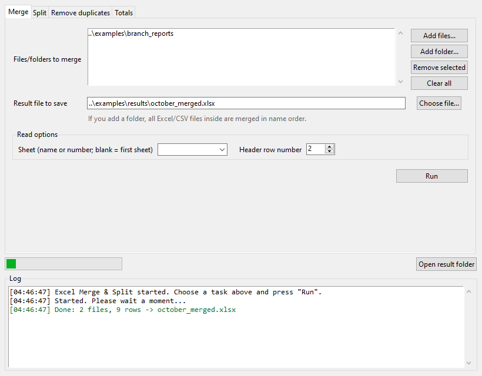
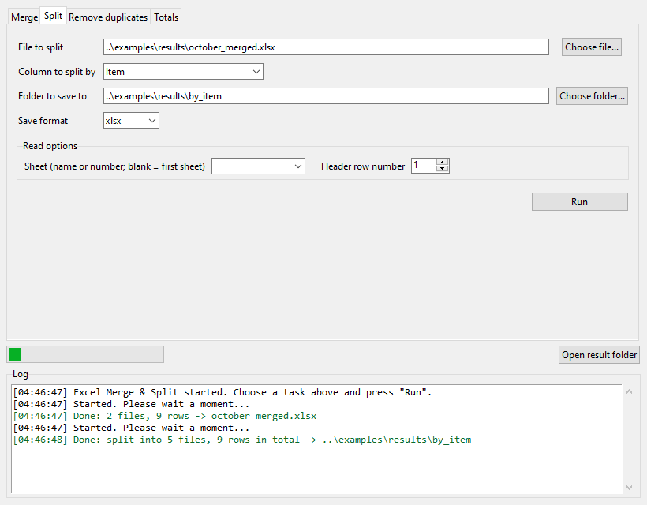
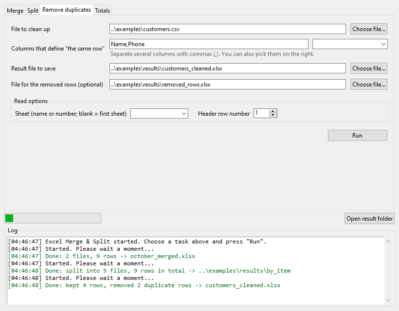
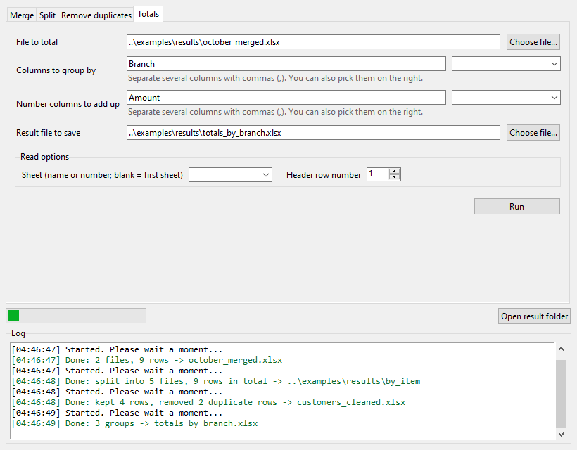

# Merge, split and dedupe Excel files

> A Windows command-line tool that merges many Excel/CSV files into one, splits a file by column value, removes duplicate rows and totals by group, with no install and no Excel required.

## The problem it solves

Staff in accounting, general affairs or sales support often get a separate Excel file from every branch or account manager each month. Copying and pasting them into one sheet, splitting a list back out per person, and hunting for repeated names and phone numbers by hand is slow and easy to get wrong.

## What it does

- Merges every xlsx and CSV in a folder into one file, matching columns by header name even when the column order differs, and adds a source-file column. A header row number can be set when a title row sits above the table.
- Splits one file into separate files, one per value of a chosen column such as account manager.
- Removes duplicate rows based on several columns and saves the removed rows to a separate file.
- Counts rows and sums amounts per group, reading numbers with thousands separators such as 1,500 as numbers.
- Saves a monthly routine (merge, dedupe, totals) as a job file so it can be rerun in one command.
- Reads Excel date cells as YYYY-MM-DD, keeps leading zeros in text codes like 001, and fills merged cells with the top-left value. Processing is local and the original files are only read.

## Demo walkthrough

This folder shows the result only: screenshots, sample input and what comes out. The tool itself is a paid product, so its source code is not published here.

1. Input: a folder of branch report xlsx files that have a title row on top. Run `xlmoa-cli.exe merge --inputs 예제/지점보고 --out 결과/취합.xlsx --header-row 2`. Result: one merged xlsx with a source-file column. In my test, two Excel-made reports (merged title cells, long-form dates, code 001) became 9 rows with dates as YYYY-MM-DD and the 001 kept.
2. Input: a 244-row customer list (public tips.csv). Result of dedupe: 2 repeated rows found, 242 rows kept, and the removed rows saved to their own file. Splitting by day gives 4 files, and the per-day totals come out as 4 groups.
3. Input: the sample job file. Run `xlmoa-cli.exe run --job 예제/작업_월마감.json`. Result: merge, dedupe and totals all run in one go and the files appear in the 예제\결과 folder.

Sample files: `sample/customers.csv`, `sample/job_month_end.json`

## Notes and limits

Paid product: the source code is not published, and this page shows demos and screenshots only. Tested on Windows 10 with files I made and public data, not on real company templates or Windows 11, and the windowed app was never opened, so the command-line tool is the part to rely on. Password-protected files and old .xls must be re-saved as xlsx, and results hold values only, without the original colors or fonts.

Tech: Excel VBA, Windows CLI, xlsx, CSV, JSON job files

## 한국어 안내 — 엑셀 여러 파일 취합·분리·중복 제거

> 지점·담당자별 엑셀과 CSV를 한 파일로 모으고, 열 값별로 나누고, 겹치는 줄을 지우고, 그룹별 합계를 내는 설치 불필요한 윈도우용 명령 창 프로그램입니다.

### 해결한 문제

총무·회계·영업지원 담당자는 매달 지점과 담당자마다 따로 온 엑셀을 하나로 붙여 넣고, 다시 사람별로 나눠 보내고, 고객 명단에서 이름·전화번호가 겹치는 줄을 눈으로 찾아야 합니다. 시간이 많이 들고 실수도 잦은 일입니다.

### 하는 일

- 폴더 안의 xlsx·CSV를 한 파일로 합칩니다. 열 순서가 달라도 열 이름으로 맞추고 어느 파일에서 왔는지 「원본파일」 열을 붙입니다. 제목 줄이 위에 있으면 머리글 줄 번호를 정해 줍니다.
- 고른 열(예: 담당자)의 값마다 파일을 따로 만들어 나눕니다.
- 여러 열을 기준으로 겹치는 줄을 지우고, 지운 줄은 별도 파일로 남깁니다.
- 그룹별 건수와 합계를 내며 「1,500」처럼 쉼표가 든 숫자도 숫자로 읽어 더합니다.
- 매달 하는 순서(취합 → 중복 제거 → 합계)를 설정 파일로 저장해 명령 한 번으로 다시 실행합니다.
- 엑셀 날짜 칸은 2026-10-05 꼴로, 「001」 같은 글자 코드는 앞자리 0을 지켜 읽고, 병합된 셀은 왼쪽 위 값으로 채웁니다. 인터넷 없이 내 컴퓨터 안에서만 처리하고 원본은 읽기만 합니다.

### 데모 보는 법

이 폴더는 화면과 표본 입력, 결과 설명만 보여 줍니다. 실제 도구는 유료 상품이라 소스 코드는 올리지 않습니다.

1. 입력: 위에 제목 줄이 있는 지점 보고 엑셀이 든 폴더. `xlmoa-cli.exe merge --inputs 예제/지점보고 --out 결과/취합.xlsx --header-row 2` 를 실행하면 원본파일 열이 붙은 취합 파일 하나가 생깁니다. 제가 시험한 엑셀 보고 파일 2개(제목 병합 셀, 「2026년 10월 21일」 형식 날짜, 코드 001)는 9줄로 모였고 날짜는 YYYY-MM-DD로 바뀌고 001은 그대로 유지됐습니다.
2. 입력: 손님 명단 244줄 파일(공개 자료 tips.csv). 중복 제거를 하면 겹치는 줄 2개를 찾아 242줄로 정리되고 지운 줄은 별도 파일로 남습니다. 요일별로 나누면 4개 파일, 요일별 합계는 4그룹으로 나옵니다.
3. 입력: 예제 작업 설정 파일. `xlmoa-cli.exe run --job 예제/작업_월마감.json` 을 실행하면 취합 → 중복 제거 → 합계가 한 번에 돌고 결과가 예제\결과 폴더에 생깁니다.

### 한계

유료 상품이라 소스 코드는 공개하지 않고 데모와 화면만 보여 드립니다. 윈도우 10에서 제가 만든 파일과 공개 자료로 확인했으며 실제 회사 양식과 윈도우 11은 시험하지 못했습니다. 창 화면 프로그램은 열어 보지 못했으니 명령 창용 프로그램을 기준으로 봐 주세요. 암호 파일과 .xls는 xlsx로 다시 저장해야 하고, 결과에는 원본 서식(색·글꼴) 없이 값만 담깁니다.

---
Category: 엑셀·VBA · Built and tested with Claude Code. Every number above comes from a real run on this machine.
