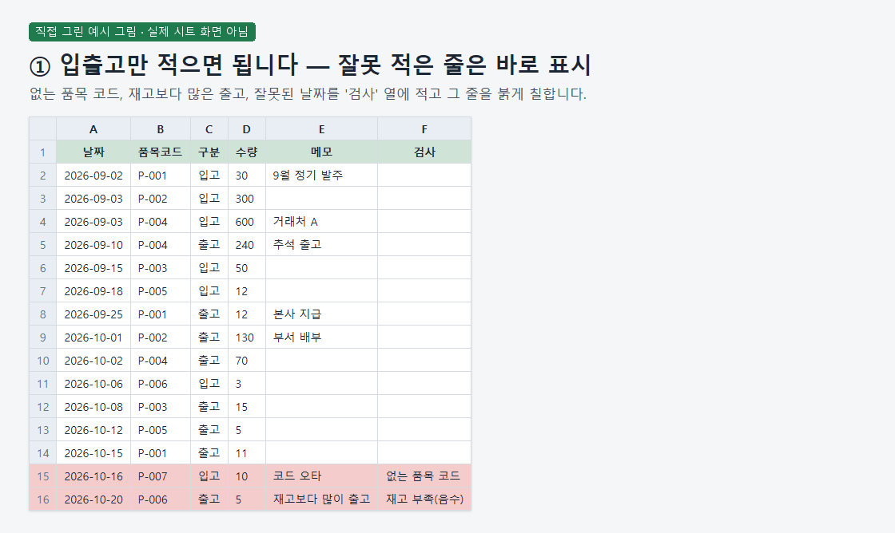
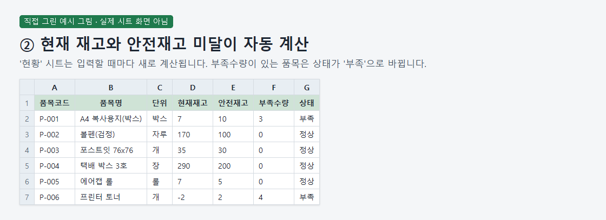
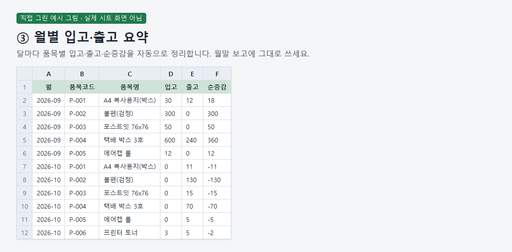
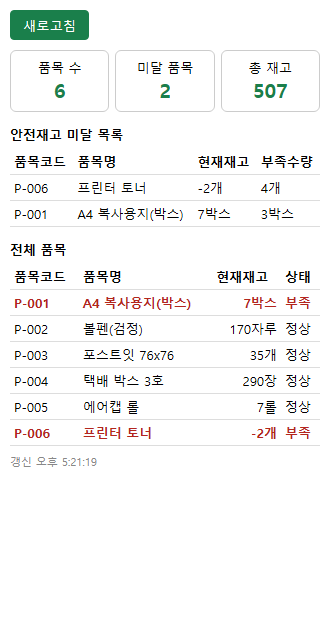

# Spreadsheet Inventory Tracking and Stock Movement

> A demo of a paid spreadsheet inventory script that calculates stock balances and monthly movements, checks entries, and provides shortage alerts, with source code kept private.

## The problem it solves

People recording inventory in a spreadsheet need to compare incoming and outgoing quantities to find current stock and shortages. Invalid item codes, incorrect dates, and withdrawals exceeding available stock also need to be identified.

## What it does

- Calculates current stock by item and lists items below their safety stock levels.
- Summarizes monthly incoming quantities, outgoing quantities, and net changes by item.
- Flags unknown item codes, invalid dates, and negative stock with red formatting and validation messages.
- Provides an inventory dashboard.
- Includes manual shortage email alerts and controls for enabling or disabling daily alerts; manual email receipt was confirmed in the seller's account.

## Demo walkthrough

This folder shows the result only: screenshots and what comes out. The tool itself is a paid product, so its source code is not published here.

1. Demo input: enter an unknown item code or an invalid date → the seller's recorded sheet run shows red formatting and a Korean validation message.
2. Demo input: record an incoming quantity of 3, followed by an outgoing quantity of 5 for the same item → the seller's recorded sheet run shows a negative-stock warning in Korean.

## Notes and limits

Actual sheet execution was recorded for one seller account in a PC browser; first-time installation in another account, current-version processing times, scheduled email arrival, behavior at 1,000 or 5,000 rows, and invalid email or alert-time handling remain unverified, while concurrent entry and mobile app entry are outside support scope. Supplied visuals are drawn examples rather than actual sheet captures, duplicate item codes produce a note rather than being blocked, barcode input and messenger alerts are absent, and Standard/Premium offerings are on hold.

Tech: Google Sheets, Google Apps Script, HTML, JSON

## 한국어 안내 — 스프레드시트 품목별 재고와 입출고 관리

> 현재 재고와 월별 입출고를 계산하고 입력 검사와 재고 미달 알림을 제공하는 유료 스프레드시트 스크립트의 데모로, 원본 코드는 공개하지 않습니다.

### 해결한 문제

스프레드시트로 재고를 관리하는 사람은 입고와 출고 내역을 대조해 현재 수량과 부족한 품목을 파악해야 합니다. 없는 품목 코드나 잘못된 날짜, 재고보다 많은 출고도 확인할 필요가 있습니다.

### 하는 일

- 품목별 현재 재고를 계산하고 안전재고 미달 품목을 정리합니다.
- 월별·품목별 입고량, 출고량, 순증감을 요약합니다.
- 없는 품목 코드, 잘못된 날짜, 음수 재고를 붉은 표시와 검사 문구로 알립니다.
- 재고 대시보드를 제공합니다.
- 미달 알림 메일 수동 발송과 매일 알림 켜기·끄기 기능이 있으며, 판매자 계정에서 수동 발송한 메일의 수신을 확인했습니다.

### 데모 보는 법

이 폴더는 화면, 결과 설명만 보여 줍니다. 실제 도구는 유료 상품이라 소스 코드는 올리지 않습니다.

1. 데모 입력: 없는 품목 코드나 잘못된 날짜 입력 → 판매자의 실제 시트 실행 기록에서 붉은 표시와 한국어 검사 문구가 나타났습니다.
2. 데모 입력: 같은 품목에 입고 3을 기록한 뒤 출고 5 입력 → 판매자의 실제 시트 실행 기록에서 「재고 부족(음수)」 표시가 나타났습니다.

### 한계

실제 시트 실행 기록은 판매자 계정 하나의 PC 브라우저 사용에 한정되며, 다른 계정의 처음 설치·현재 판 처리 시간·정해진 시각의 자동 메일 도착·1000행 및 5000행 동작·잘못된 메일 주소와 알림 시각 처리는 미확인이고, 동시 입력과 휴대폰 앱 입력은 지원 범위 밖입니다. 제공된 시각 자료는 실제 시트 캡처가 아닌 예시 그림이며, 품목코드 중복은 차단하지 않고 메모로 알리고, 바코드 입력과 메신저 알림은 포함되지 않으며, 표준·프리미엄은 제공 보류 상태입니다.

---
Category: 엑셀·VBA · Built and tested with Claude Code. Every number above comes from a real run on this machine.
