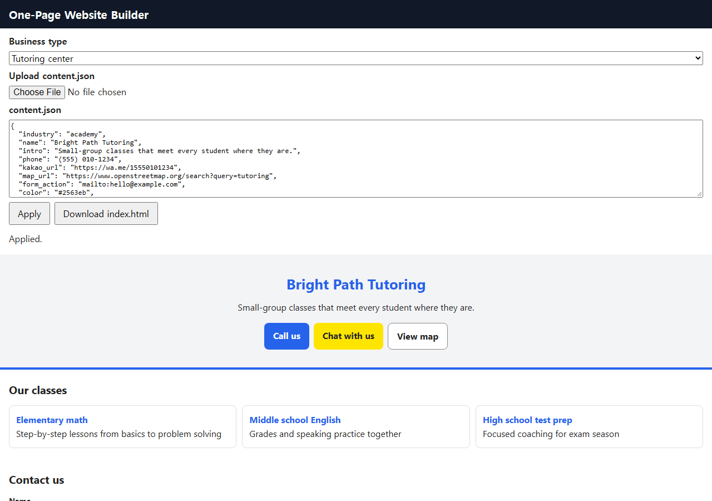
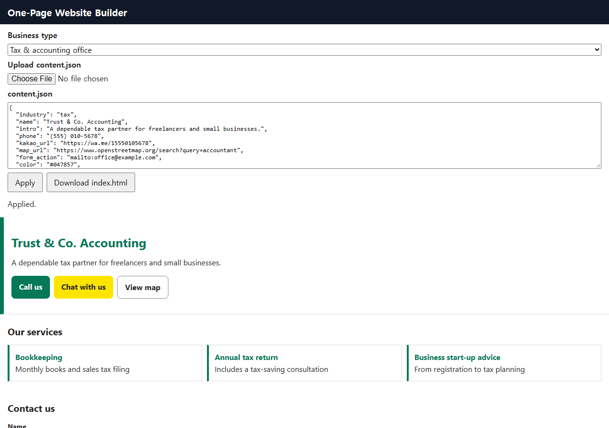
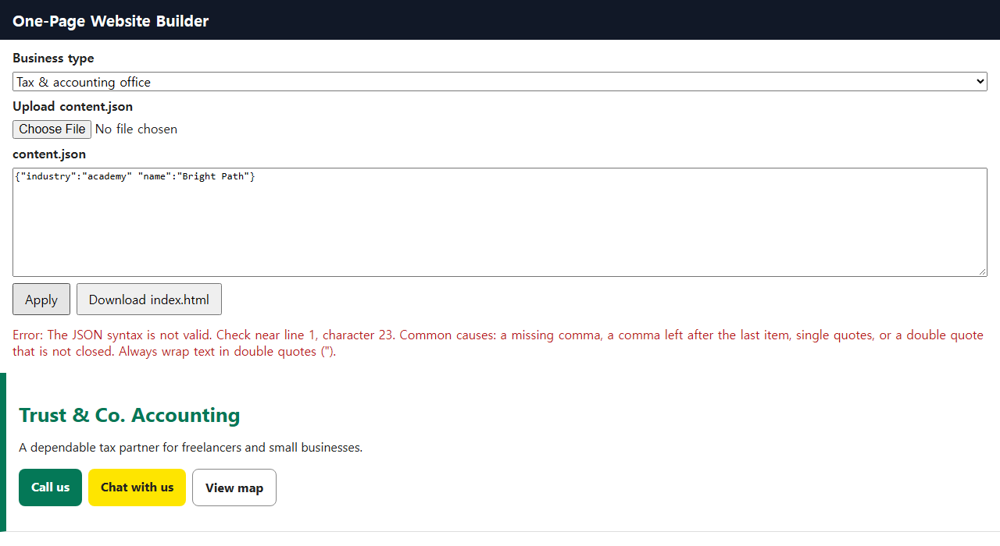
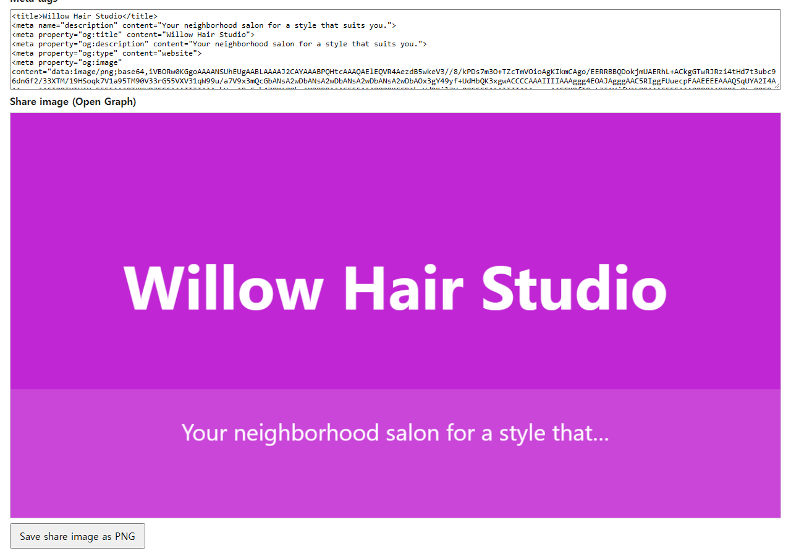

# One-page website maker for small shops

> A browser tool that turns a business name, intro and phone number into a single-file one-page website and a share image, with no install or sign-up.

## The problem it solves

Owners of tutoring centers, tax and legal offices and hair salons often just need one page with a phone number, photos and a contact form. Hiring someone or learning a site builder is more than that takes. This tool lets them fill in a short content file and get the page themselves.

## What it does

- Runs by opening index.html in a browser: no install, no internet needed, and the builder screen sends no requests to outside servers.
- Pick a business type (tutoring center, tax office or salon), enter name, intro, phone, services, photos and address in content.json form, or upload a JSON file, and see a live preview.
- Builds the page in this order: name and intro, call / chat / map buttons, photos, service list, contact form with labels and required marks, address. Brand color, photo alt text and a privacy notice for the form are set through content.json.
- Generates share meta tags and a 1200×630 share image that can be saved as PNG; the hosted image address goes in og_image_url.
- When the input is wrong, it reports the line number and how to fix it in Korean, and blocks unsafe addresses such as javascript: links.
- Downloads one index.html with all styles included, ready to upload to any hosting.

## Demo walkthrough

This folder shows the result only: screenshots, sample input and what comes out. The tool itself is a paid product, so its source code is not published here.

1. Input: choose the tutoring-center type and load the made-up example examples/academy.json (name, phone, services, photos, address) with Upload content.json.
2. Result: the preview shows the finished page right away, and Download index.html saves it as one file. In the automated run, python main.py build academy produced a 53,985-byte page.
3. Check: python main.py check academy captures the page at 375px and 1280px and tests horizontal scroll, images and links. On a phone-width screen, photos, the service list and the contact form stack in one column.

Sample files: `sample/academy.json`, `sample/salon.json`, `sample/tax.json`

## Notes and limits

There are three templates with the same structure, differing only in color use, alignment and corner rounding, and the result is a single page with no login, reservations, payments or boards. Checks were automated in headless Chromium; real chat-app share previews, live hosting, Mac and phone browsers, and the mailto form in a real mail program were not tested, and the privacy notice and its legal requirements are up to the user.

Tech: HTML, CSS, JavaScript, Python, Playwright

## 한국어 안내 — 소상공인 한 장짜리 홈페이지 제작 도구

> 상호·소개·전화번호를 입력하면 설치나 가입 없이 브라우저에서 한 장짜리 홈페이지 파일 1개와 공유 이미지를 만들어 주는 도구입니다.

### 해결한 문제

학원, 세무·법률 사무소, 미용실 사장님은 전화번호와 사진, 문의 폼이 있는 홍보 페이지 한 장이면 충분한 경우가 많습니다. 하지만 제작을 맡기거나 빌더를 새로 배우기에는 부담이 큽니다. 짧은 입력 파일만 채우면 직접 페이지를 만들 수 있게 했습니다.

### 하는 일

- 브라우저에서 index.html을 열기만 하면 실행됩니다. 설치와 인터넷 연결이 필요 없고, 빌더 화면은 외부로 요청을 보내지 않습니다.
- 업종(학원·세무사·미용실)을 고르고 content.json 형식으로 상호, 소개, 전화번호, 서비스, 사진, 주소를 입력하거나 JSON 파일을 올리면 바로 미리보기가 나옵니다.
- 페이지는 상호·소개, 전화하기/상담/지도 보기 버튼, 사진, 서비스 목록, 문의 폼(라벨·필수 표시), 주소 순서로 구성됩니다. 대표 색상, 사진 설명(alt), 폼의 개인정보 안내 문구는 content.json 항목으로 넣습니다.
- 공유용 메타 태그와 1200×630 공유 이미지를 만들고, 이미지는 PNG로 저장할 수 있습니다. 올린 이미지 주소는 og_image_url에 적습니다.
- 입력이 틀리면 몇 번째 줄인지와 고치는 방법을 한국어로 알려 주고, javascript: 같은 위험한 주소는 막습니다.
- 스타일이 모두 들어간 index.html 1개를 내려받아 호스팅에 올리면 됩니다.

### 데모 보는 법

이 폴더는 화면과 표본 입력, 결과 설명만 보여 줍니다. 실제 도구는 유료 상품이라 소스 코드는 올리지 않습니다.

1. 입력: 업종에서 학원을 고르고, 직접 만든 가짜 예제 examples/academy.json(상호·전화번호·서비스·사진·주소)을 content.json 올리기로 불러옵니다.
2. 결과: 미리보기에 완성된 페이지가 바로 나타나고, 내려받기를 누르면 index.html 1개로 저장됩니다. 자동 실행에서는 python main.py build academy 로 53,985바이트짜리 페이지가 만들어졌습니다.
3. 검사: python main.py check academy 는 완성 페이지를 375px·1280px 폭으로 찍고 가로 스크롤, 이미지, 링크를 검사합니다. 모바일 폭에서는 사진·서비스 목록·문의 폼이 한 열로 나옵니다.

### 한계

템플릿은 구조가 같은 3종이고 색 사용, 정렬, 모서리 둥글기만 다르며, 결과물은 로그인·예약·결제·게시판이 없는 한 페이지입니다. 확인은 헤드리스 Chromium 자동 실행으로 했고, 메신저 앱의 실제 공유 화면, 실제 호스팅, 맥·휴대폰 브라우저, 실제 메일 프로그램에서의 mailto 폼은 확인하지 못했습니다. 개인정보 안내 문구와 법적 요건 확인은 사용자 몫입니다.

---
Category: 웹사이트 · Built and tested with Claude Code. Every number above comes from a real run on this machine.
