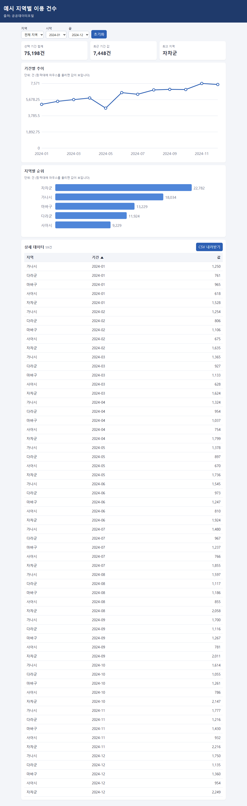
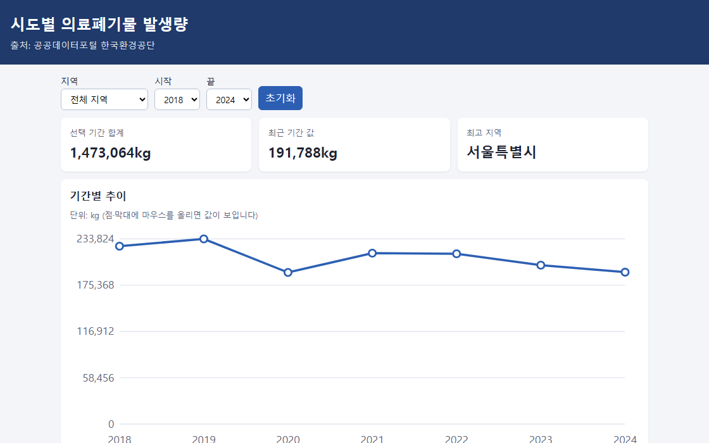
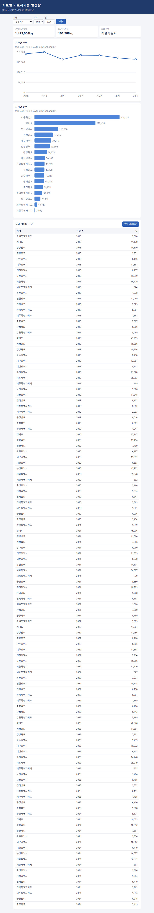

# Static dashboard from public-data CSV

> A demo that cleans one Korean public-data CSV with a Python script and turns it into a server-free dashboard with filters, KPI cards, SVG charts and a sortable table.

## The problem it solves

Government CSV files often come with inconsistent column names, mixed date formats, numbers written with commas, blanks or dashes, and a mix of UTF-8 and CP949 encodings. Anyone who downloads one to report on regional figures has to clean it by hand before a chart is even possible.

## What it does

- build.py picks the region, period and value columns and saves the cleaned result as JSON and JS files.
- Periods such as 2023, 2023.02 or 2023년 3월 are normalized to YYYY or YYYY-MM; commas and spaces are stripped from values; unparseable rows are dropped and counted; duplicate region-and-period rows are summed.
- Reads UTF-8 first and falls back to CP949.
- The static page needs no network requests: region and period filters with a reset button, three KPI cards, an SVG trend line chart and an SVG ranking bar chart.
- A detail table sorts by clicking a column header (Enter and Space also work), and the current view can be downloaded as a UTF-8 CSV with a BOM.
- The layout shows no horizontal page scroll at 375px width, checked with tests/browser_check.py in headless Chromium.

## How to run

1. Install nothing beyond Python 3; the script uses only the standard library. If `python` doesn't work on Windows, use `py`.
2. Open index.html in a browser to see the dashboard built from the cleaned public data that is already included.
3. Build the practice example from the synthetic CP949 CSV (this overwrites 예제/결과/data.js and data.json): python build.py --input 예제/지역별_월별_예시.csv --region-col 지역 --period-col 기준월 --value-col "이용 건수" --outdir 예제/결과 --title "예시 지역별 이용 건수" --unit 건 --source "직접 만든 가상 자료"
4. Open 예제/결과/index.html to see the result.
5. For your own file, point the script at its column names (this overwrites data/data.json and data/data.js, so copy the data folder first): python build.py --input 내파일.csv --region-col 지역열이름 --period-col 기간열이름 --value-col 값열이름 --title "내 제목" --unit 단위 --source "내 자료 이름"

Sample files: `예제/README.txt`, `예제/지역별_월별_예시.csv`, `예제/결과/data.json`

## Notes and limits

It handles one CSV with three columns (region, period, value) at a time and is not meant for very large files. The real sample data had 0 dropped rows, so the comma, dash and month rules were only exercised on a synthetic example; charts have no legend, tooltips may not appear on touch screens, and I haven't checked the page in other browsers or opened the exported CSV in Excel. The original CSV is not included, and its terms of use were not recorded, so check them at the source before redistributing the cleaned data.

Tech: Python 3, HTML, CSS, JavaScript, SVG

## 한국어 안내 — 공공데이터 CSV 지역 통계 대시보드

> 공공데이터포털 CSV 한 개를 파이썬으로 정제해, 서버 없이 열리는 필터·지표 카드·SVG 차트·정렬 표 대시보드로 만든 시연물입니다.

### 해결한 문제

공공데이터 CSV는 열 이름, 날짜 표기, 숫자 표기(쉼표, 빈 칸, '-')가 제각각이고 인코딩도 UTF-8과 CP949가 섞여 있습니다. 지역별 수치를 보고하려고 파일을 내려받은 사람은 차트를 그리기 전에 먼저 손으로 정리해야 합니다.

### 하는 일

- build.py가 지역·기간·값 열을 골라 정제한 뒤 JSON과 JS 파일로 저장합니다.
- 2023, 2023.02, 2023년 3월 같은 기간 표기를 YYYY 또는 YYYY-MM으로 맞추고, 값의 쉼표·공백을 지우며, 해석할 수 없는 행은 버리고 그 수를 기록합니다. 같은 지역·기간이 여러 번 나오면 값을 더합니다.
- 인코딩은 UTF-8을 먼저 시도하고 실패하면 CP949로 읽습니다.
- 정적 페이지는 네트워크 요청 없이 지역·시작 기간·끝 기간 필터와 초기화 버튼, 핵심 지표 카드 3개, SVG 추이 선그래프, SVG 지역별 순위 막대그래프를 보여 줍니다.
- 상세 표는 열 머리글을 눌러(Enter·Space 지원) 정렬하고, 현재 필터·정렬 결과를 UTF-8(BOM 포함) CSV로 내려받을 수 있습니다.
- 375px 폭에서 페이지 가로 스크롤이 생기지 않는 배치이며, tests/browser_check.py를 헤드리스 Chromium에서 돌려 확인했습니다.

### 실행 방법

1. Python 3만 있으면 되고 추가 설치는 없습니다(표준 라이브러리만 사용). 윈도에서 `python`이 안 되면 `py`로 바꿔 입력합니다.
2. index.html을 브라우저로 열면 이미 들어 있는 정제된 공공데이터로 만든 대시보드가 보입니다.
3. 직접 만든 가상 CP949 CSV로 연습용 예제를 만듭니다(예제/결과/data.js, data.json을 덮어씁니다): python build.py --input 예제/지역별_월별_예시.csv --region-col 지역 --period-col 기준월 --value-col "이용 건수" --outdir 예제/결과 --title "예시 지역별 이용 건수" --unit 건 --source "직접 만든 가상 자료"
4. 예제/결과/index.html을 열어 결과를 확인합니다.
5. 내 파일은 열 이름만 바꿔 같은 방식으로 만듭니다(data/data.json, data/data.js를 덮어쓰므로 data 폴더를 먼저 복사해 두세요): python build.py --input 내파일.csv --region-col 지역열이름 --period-col 기간열이름 --value-col 값열이름 --title "내 제목" --unit 단위 --source "내 자료 이름"

### 한계

한 번에 CSV 한 개의 세 열(지역·기간·값)만 다루며 매우 큰 파일에는 맞지 않습니다. 실제 자료에서는 버려진 행이 0건이라 쉼표·'-'·월 표기 규칙은 가상 예제로만 확인했고, 차트에는 범례가 없으며 터치 화면에서는 값 툴팁이 안 뜰 수 있습니다. 다른 브라우저 화면과 내려받은 CSV의 엑셀 열기는 확인하지 못했습니다. 원본 CSV는 넣지 않았고 이용 조건도 기록하지 못했으니, 정제 결과를 재배포하기 전에 출처에서 조건을 확인해야 합니다.

---
Category: 웹사이트 · Built and tested with Claude Code. Every number above comes from a real run on this machine.
